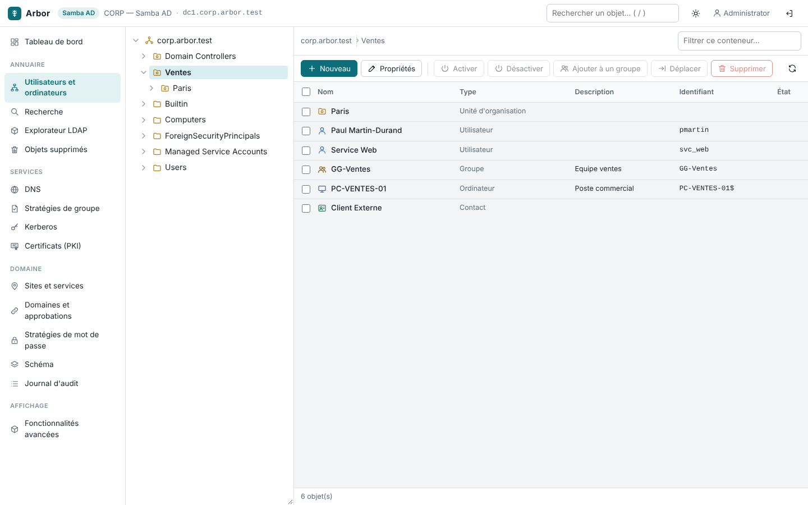

# Arbor — console web d'administration d'annuaire

Arbor est une interface web d'administration pour **Active Directory, Samba AD, OpenLDAP et 389-DS**, et pour les services qui gravitent autour : **DNS, DHCP, stratégies de groupe, Kerberos et PKI**. Elle reprend le périmètre des outils RSAT de Windows (ADUC, ADSI Edit, Gestionnaire DNS, console DHCP, GPMC, Sites et services, Domaines et approbations…) dans un **binaire unique** écrit en Rust, qui fonctionne sous Linux comme sous Windows.



## Points clés

- **Un seul exécutable** (≈ 12 Mo) : gabarits HTML, CSS, JavaScript et icônes sont embarqués. Aucune dépendance OpenSSL : TLS est assuré par `rustls`, avec le magasin de certificats du système (Windows ou Linux).
- **Modèle de sécurité calqué sur RSAT** : chaque utilisateur se connecte avec son propre compte d'annuaire. Toutes les opérations s'exécutent avec **ses** droits ; Arbor n'a pas de compte de service privilégié.
- **Multi-annuaire** : un même serveur peut gérer plusieurs domaines ou annuaires (choix à la connexion). Le type de serveur est détecté automatiquement via le RootDSE.
- **Rapide et léger** : Axum + Tokio, rendu côté serveur et htmx (≈ 60 Ko de JavaScript, sans framework). Environ 30 Mo de mémoire en service ; une fiche utilisateur s'affiche en moins de 10 ms, une OU de 3 000 objets en 0,6 s, l'essentiel de ce temps étant celui du serveur LDAP (mesures sur Samba AD). Les sockets LDAP et HTTPS sont ouvertes avec `TCP_NODELAY`, ce qui évite environ 40 ms de latence par opération.
- **Traçabilité** : chaque modification est consignée dans un journal d'audit (JSON Lines) consultable dans l'interface.

## Correspondance avec RSAT

| Outil RSAT | Dans Arbor | Fonctions |
|---|---|---|
| Utilisateurs et ordinateurs AD (dsa.msc) | **Utilisateurs et ordinateurs** | Arborescence, création (utilisateur, groupe, OU, ordinateur, contact), fiches à onglets (Général, Compte, Adresse, Profil, Téléphones, Organisation, Membre de, Membres, Géré par, Attributs UNIX), mot de passe, activation, déverrouillage, renommage, déplacement, suppression récursive, actions groupées, appartenance effective (groupes imbriqués), LAPS, clés BitLocker |
| ADSI Edit / éditeur d'attributs | **Explorateur LDAP**, onglet **Éditeur d'attributs** | Navigation brute dans toutes les partitions, édition de tout attribut (texte, hexadécimal, base64) guidée par le schéma, attributs possibles non définis, téléchargement des valeurs binaires |
| Requêtes enregistrées / Rechercher | **Recherche** | Jusqu'à 23 requêtes prêtes (comptes désactivés, verrouillés, inactifs, sans pré-authentification, délégation non contrainte, Kerberoasting…), filtre LDAP brut, colonnes au choix, export CSV |
| Gestionnaire DNS | **DNS** | Zones intégrées AD (directes et inverses), enregistrements A, AAAA, CNAME, MX, SRV, TXT, PTR, NS, SOA, création automatique du PTR, création/suppression de zones, nettoyage des enregistrements dynamiques obsolètes ; zones LDAP « dnszone » (BIND, PowerDNS) pour OpenLDAP |
| Console DHCP | **DHCP** (ISC Kea) | Étendues, taux d'utilisation, options, réservations, baux |
| Gestion des stratégies de groupe (GPMC) | **Stratégies de groupe** | Création (annuaire + SYSVOL), état, renommage, liens (activation, application forcée, ordre), blocage d'héritage, **calcul de l'héritage effectif**, filtrage de sécurité, extensions configurées, cohérence des versions AD / SYSVOL |
| setspn, ktpass, onglet Délégation | **Kerberos** | SPN (ajout, retrait, recherche, doublons), types de chiffrement, délégation non contrainte, contrainte et RBCD, **génération de keytabs** (AES256, AES128, RC4) |
| pkiview, certtmpl, onglet Certificats publiés | **Certificats (PKI)** | Autorités, services d'inscription, modèles avec **détection des risques ESC1 à ESC4**, magasin NTAuth, certificats publiés sur les objets, expirations, sonde du certificat LDAPS |
| Sites et services AD | **Sites et services** | Sites, serveurs, sous-réseaux (création, suppression), liens de sites |
| Domaines et approbations AD | **Domaines et approbations** | Approbations (direction, type, transitivité, filtrage SID) |
| Stratégies de mot de passe, Centre d'administration | **Stratégies de mot de passe** | Stratégie du domaine, PSO (stratégies affinées), objets `pwdPolicy` d'OpenLDAP |
| Corbeille AD | **Objets supprimés** | Liste et restauration |
| Schéma AD (schmmgmt.msc) | **Schéma** | Classes et attributs, attributs obligatoires et facultatifs |
| — | **Tableau de bord** | Rôles FSMO, contrôleurs de domaine, statistiques, contrôles de santé et de sécurité |

## Annuaires pris en charge

| Fonction | Active Directory / Samba AD | OpenLDAP | 389-DS / autre LDAP |
|---|---|---|---|
| Utilisateurs, groupes, OU, contacts | ✔ | ✔ (`inetOrgPerson` + `posixAccount`) | ✔ |
| Mot de passe | `unicodePwd` (LDAPS/StartTLS requis) | extension Password Modify (RFC 3062) | idem, repli `{SSHA}` |
| Désactivation / verrouillage | `userAccountControl`, `lockoutTime` | overlay ppolicy (`pwdAccountLockedTime`) | `nsAccountLock` |
| Changement de mot de passe obligatoire | `pwdLastSet = 0` | `pwdReset` | — |
| Groupes | `member` | `groupOfNames`, `groupOfUniqueNames`, `posixGroup`, RFC 2307bis (configurable) | idem |
| Allocation `uidNumber` / `gidNumber` | option | ✔ | ✔ |
| DNS | zones intégrées (MicrosoftDNS) | schéma `dnszone` | schéma `dnszone` |
| GPO, sites, approbations, PSO, corbeille, LAPS, BitLocker | ✔ | — | — |
| Stratégies de mot de passe | domaine + PSO | objets `pwdPolicy` | — |
| Keytabs | réinitialisation du compte puis génération (comme ktpass) | à partir d'un mot de passe connu | idem |

## Démarrage rapide

```bash
cargo build --release              # Linux ou Windows (toolchain MSVC)
./target/release/arbor init-config arbor.toml
# éditer arbor.toml (URL des contrôleurs, AC, etc.)
./target/release/arbor -c arbor.toml check   # vérifie la connectivité de chaque annuaire
./target/release/arbor -c arbor.toml         # https://<serveur>:8443
```

Au premier démarrage, un certificat auto-signé est créé dans `data/` ; remplacez-le par un certificat de votre PKI (`tls = "files"`).

## Configuration

Fichier TOML ; `arbor init-config` produit un exemple commenté. Extrait :

```toml
[server]
listen = "0.0.0.0:8443"
tls = "files"                      # "self-signed" | "files" | "off" (derrière un reverse-proxy)
tls_cert = "/etc/arbor/cert.pem"
tls_key  = "/etc/arbor/key.pem"
data_dir = "/var/lib/arbor"        # certificat auto-signé, journal d'audit

[security]
session_idle_minutes = 30
session_max_hours = 10
max_login_failures = 10            # par adresse IP, sur 15 minutes

[[directory]]
id = "corp"
name = "CORP — Active Directory"
urls = ["ldaps://dc1.corp.example", "ldaps://dc2.corp.example"]   # basculement automatique
ca_file = "/etc/arbor/corp-root-ca.pem"   # facultatif : sinon magasin du système

[directory.login]
default_upn_suffix = "corp.example"
required_group = "CN=Arbor-Admins,OU=Groupes,DC=corp,DC=example"   # facultatif

[directory.gpo]
sysvol_path = '\\corp.example\SYSVOL\corp.example\Policies'      # Windows (UNC)
# sysvol_path = "/var/lib/samba/sysvol/corp.example/Policies"    # Arbor installé sur un DC Samba

[[directory.dhcp]]
id = "dhcp1"
name = "DHCP site principal"
url = "http://dhcp1.corp.example:8000"     # kea-ctrl-agent
service = "dhcp4"

[[directory]]
id = "lab"
name = "LAB — OpenLDAP"
urls = ["ldap://ldap.lab.example"]
starttls = true
base_dn = "dc=lab,dc=example"

[directory.login]
user_filter = "(|(uid={user})(mail={user}))"
# lookup_bind_dn / lookup_bind_password si la recherche anonyme est interdite

[directory.posix]
group_style = "group-of-names"     # group-of-names | group-of-unique-names | posix-group | rfc2307bis
uid_number_start = 10000
default_gid_number = 10000

[directory.dns]
provider = "dnszone"
dnszone_base = "ou=dns,dc=lab,dc=example"
```

Autres options utiles : `flavor` (forcer `active-directory`, `samba`, `openldap`, `389ds`, `generic`), `tls_insecure` (tests uniquement), `timeout_secs`, `max_list_entries`, `posix.ad_posix_attributes`, `posix.tree_container_classes`, `kerberos.realm`, `server.trust_proxy_headers`, `audit.path`.

> **Samba** : le certificat généré automatiquement par Samba ne contient pas de *Subject Alternative Name* ; il est (à juste titre) refusé par rustls. Utilisez un certificat émis par votre AC (`tls certfile/keyfile/cafile` dans `smb.conf`).

## Déploiement

**Linux (systemd)** : `packaging/arbor.service` fournit une unité durcie (utilisateur dédié, `ProtectSystem=strict`, etc.).

```bash
useradd --system --home /var/lib/arbor arbor && install -d -o arbor /var/lib/arbor
install -m 755 target/release/arbor /usr/local/bin/ && install -D -m 640 arbor.toml /etc/arbor/arbor.toml
cp packaging/arbor.service /etc/systemd/system/ && systemctl enable --now arbor
```

**Windows** : compilez avec la fonctionnalité de service natif puis lancez le script d'installation (PowerShell administrateur) :

```powershell
cargo build --release --features windows-service
.\packaging\install-windows.ps1
sc.exe start Arbor
```

Le service se place dans le dossier de la configuration (`C:\ProgramData\Arbor`) et journalise dans `data\arbor.log`. Sans cette fonctionnalité, l'exécutable fonctionne en mode console (ou derrière NSSM / WinSW).

**Reverse-proxy** : `tls = "off"`, écoute sur `127.0.0.1` et `trust_proxy_headers = true` pour journaliser l'adresse réelle du client.

## Sécurité

- **Authentification** : bind LDAP simple avec les identifiants de l'utilisateur (UPN, `DOMAINE\utilisateur`, DN ou identifiant recherché par filtre). Les mots de passe vides sont refusés (pas de bind anonyme déguisé). Accès restreignable à un groupe (`required_group`, groupes imbriqués pris en compte sur AD).
- **Sessions** côté serveur : le navigateur ne reçoit qu'un identifiant aléatoire de 256 bits (cookie `HttpOnly`, `Secure`, `SameSite=Strict`). Les identifiants restent en mémoire (effacés à la libération) et servent à rouvrir la connexion LDAP. Expiration sur inactivité et durée maximale.
- **Anti-CSRF** : jeton par session exigé sur toute requête modifiante, plus contrôle de l'en-tête `Origin` (HTTP/1.1 et HTTP/2).
- **En-têtes** : CSP stricte (aucun script en ligne ni `eval`), `X-Frame-Options: DENY`, `nosniff`, `Referrer-Policy: no-referrer`, HSTS, `Cache-Control: no-store`.
- **Limitation des tentatives** de connexion par adresse IP ; messages d'erreur AD décodés (compte verrouillé, désactivé, expiré…).
- **Audit** : connexions, toutes les modifications, lectures sensibles (LAPS, BitLocker), exports CSV et générations de keytab.
- Les keytabs sont servis par un lien **à usage unique** valable 10 minutes.

### Droits nécessaires (Active Directory)

Arbor n'exige aucun droit particulier : il fait ce que le compte connecté a le droit de faire. Pour une délégation fine :

| Fonction | Droit requis |
|---|---|
| Comptes et groupes | délégation sur les OU concernées (création/suppression d'objets, réinitialisation de mot de passe, écriture des attributs) |
| DNS | membre de `DnsAdmins` ou droits sur `CN=MicrosoftDNS` |
| GPO | `Group Policy Creator Owners` (création), droit d'écriture sur `gPLink` des OU (liens), accès en écriture au partage SYSVOL depuis le serveur Arbor |
| Délégation non contrainte | privilège `SeEnableDelegationPrivilege` (Admins du domaine par défaut) |
| LAPS / BitLocker | droits de lecture des attributs confidentiels correspondants |
| Sites, PSO, stratégie du domaine | droits sur la partition de configuration / `CN=System` |

## Architecture

```
src/
├── main.rs                 CLI (run, check, init-config, service) et serveur HTTPS
├── config.rs               configuration TOML multi-annuaire
├── audit.rs                journal d'audit JSON Lines
├── ldap/                   couche LDAP commune
│   ├── conn.rs             TLS rustls, basculement entre URL, sonde de certificats
│   ├── dir.rs              recherches paginées, plages de valeurs, suppression récursive
│   ├── flavor.rs           détection AD / Samba / OpenLDAP / 389-DS via le RootDSE
│   ├── schema.rs           analyse du sous-schéma (RFC 4512 et règles de contenu AD)
│   ├── security.rs         descripteurs de sécurité Windows, SID, RBCD
│   └── codec.rs, dn.rs     SID, GUID, FILETIME, userAccountControl, DN (RFC 4514)
├── directory/              modèle « Utilisateurs et ordinateurs »
│   ├── kinds.rs            classification des objets et état des comptes
│   ├── sheets.rs           fiches de propriétés décrites par des données
│   └── ops.rs              opérations abstraites par type de serveur
├── services/
│   ├── dns/                MicrosoftDNS (codec binaire dnsRecord) et dnszone
│   ├── dhcp.rs             client de l'API Kea
│   ├── gpo.rs              gPLink, héritage, GPC + GPT (SYSVOL)
│   ├── kerberos/           dérivation de clés RFC 3961/3962 et format keytab
│   └── pki.rs              X.509, inventaire AD CS, analyse ESC1 à ESC4
├── web/                    Axum : sessions, authentification, CSRF, pages
└── winsvc.rs               service Windows natif (fonctionnalité windows-service)
templates/                  gabarits Askama (compilés et vérifiés à la compilation)
static/                     CSS, JavaScript (sans eval), icônes, htmx
```

Les fiches de propriétés sont **décrites par des données** (`directory/sheets.rs`) : ajouter un champ à un onglet revient à ajouter une ligne. Les écarts entre serveurs sont isolés dans `directory/ops.rs`.

## Validation

Les tests ont été menés contre de vrais serveurs installés pour l'occasion :

- **Samba AD DC 4.19** : création, modification et suppression d'objets, mots de passe (le refus de stratégie remonte un message clair et le compte reste désactivé), appartenance, déplacement, renommage, onglet Sécurité, PSO et stratégie du domaine (contrôlées avec `samba-tool`), réanimation d'objets supprimés.
- **DNS** : toutes les opérations vérifiées par des requêtes `dig` sur le DNS de Samba (A, AAAA, CNAME, MX, SRV, TXT, PTR automatique, zones créées par Arbor, incrément du numéro de série SOA).
- **Kerberos** : les clés AES256, AES128 et RC4 générées par Arbor sont **identiques octet pour octet** à celles du KDC (`samba-tool domain exportkeytab`) ; `kinit -k` avec le keytab produit réussit et le ticket de service est validé par `kvno -k`.
- **GPO** : création dans l'annuaire et dans SYSVOL, liens, application forcée, blocage d'héritage, priorités conformes à la GPMC.
- **OpenLDAP 2.6** (ppolicy, memberof, refint, dnszone) : connexion par `uid`, StartTLS, droits délégués par ACL de groupe, allocation `uidNumber`, `pwdReset`, verrouillage, groupes `groupOfNames` (valeur d'attente gérée), DNS dnszone.
- **ISC Kea 2.4** : étendues, statistiques, réservations persistées (`config-write`), suppression de baux.
- **Navigateur** (Chrome headless) : parcours complet sans erreur JavaScript — navigation, arborescence, création par dialogue, sélection multiple, sélecteur d'objets, dialogues imbriqués, notifications.
- **Sécurité** : redirection sans session, refus sans jeton CSRF ou avec origine étrangère, limitation des tentatives, en-têtes vérifiés.
- **27 tests unitaires** (`cargo test`), dont les vecteurs officiels n-fold (RFC 3961) et AES string-to-key (RFC 3962), et l'aller-retour de chaque type d'enregistrement DNS.

## Limites connues et pistes

- **Windows** : le code est portable (dépendances 100 % Rust, parties spécifiques isolées), mais la cible Windows n'a pas pu être compilée dans l'environnement de développement ; le module de service a été écrit contre l'API exacte de `windows-service` 0.8.1. À valider sur une machine Windows.
- Validé sur **Samba AD** ; les comportements propres à Windows Server (délai de prise en compte des nouvelles zones par le serveur DNS, ACL SYSVOL des GPO créées) restent à vérifier sur un vrai AD.
- **GPO** : gestion des objets et des liens, pas d'édition des paramètres eux-mêmes (`Registry.pol`, `GptTmpl.inf`) — utilisez la GPMC ou `samba-tool` pour cela.
- **DHCP** : ISC Kea uniquement (le serveur DHCP Windows n'expose qu'une interface RPC).
- **DNS** : zones AD et `dnszone` ; pas encore de mises à jour RFC 2136 (BIND en fichiers, Knot…).
- **PKI** : inventaire et publication de certificats, pas d'émission ni de révocation.
- Onglet Sécurité en lecture seule ; mots de passe Windows LAPS chiffrés non déchiffrables (DPAPI-NG) ; écriture RBCD refusée par Samba 4.19 (non vérifiée sur Windows Server, où cet attribut est normalement modifiable).
- Connexion par mot de passe (bind simple sur TLS) ; l'authentification unique Kerberos/SPNEGO est une évolution naturelle.
- Sessions en mémoire : un redémarrage impose de se reconnecter ; une seule instance.

Pistes : SSO Kerberos, fournisseur DNS RFC 2136, import CSV en masse, éditeur d'ACL, lecture des paramètres de GPO, interface multilingue.

## Licences tierces

htmx (BSD Zero-Clause, `static/htmx.LICENSE`) ; dépendances Rust sous licences permissives (MIT, Apache-2.0, ISC, BSD), voir les métadonnées de chaque crate.
